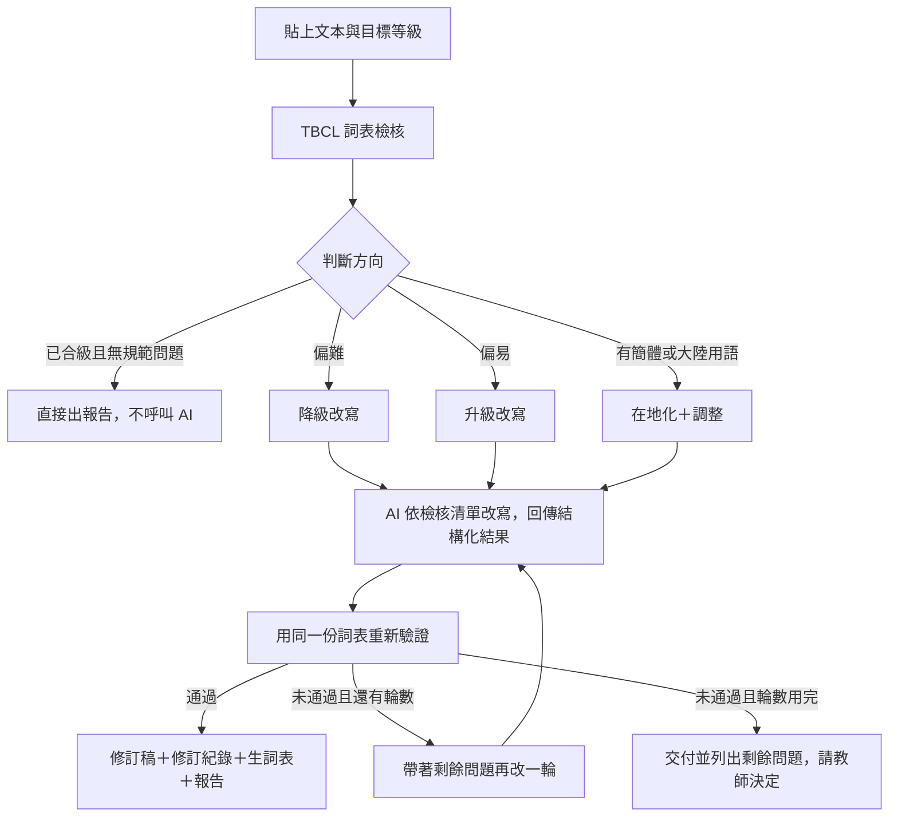
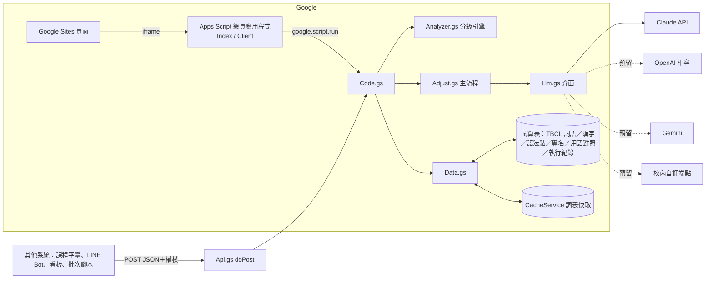

# 分級讀本調級機器人：設計說明

版本 1.2.0｜資料查核 2026-10｜分級依據以國教院、華測會官網為準

## 1. 定位

| 項目 | 內容 |
|---|---|
| 使用者 | 華語文中心教師、教材編輯、分級讀本作者 |
| 輸入 | 一章或一段讀本文本（正體或簡體），目標 TBCL 等級 |
| 輸出 | 等級診斷、調整後文本、修訂紀錄、建議生詞表、編修報告、對標陳述 |
| 原則 | **等級由詞表判斷，AI 只負責改寫**。每一個等級數字都說得出依據（哪一版詞表、哪個門檻），AI 的等級說法一律標「推估」 |

為什麼這樣分工：LLM 對「某個詞是 TBCL 第幾級」的記憶不可靠，但很擅長在給定限制下改寫得自然。所以程式先用官方詞表找出問題、交給 AI 改，改完再用同一份詞表驗證，形成閉環。

## 2. 分級依據

| TBCL | 等 | TOCFL | CEFR | 累計詞語 | 累計漢字 | 累計語法點 | 文本類型 | 建議平均句長* |
|---|---|---|---|---|---|---|---|---|
| 第 1 級 | 基礎 | 準備級（Novice 1–2） | Pre-A1 | 401 | 246 | 15 | 單詞、固定短語、極短問答 | ≤8 字 |
| 第 2 級 | 基礎 | 入門級（Level 1） | A1 | 804 | 504 | 107 | 短句、簡短對話 | ≤10 字 |
| 第 3 級 | 基礎 | 基礎級（Level 2） | A2 | 1,265 | 801 | 241 | 完整句子、簡短段落 | ≤13 字 |
| 第 4 級 | 進階 | 進階級（Level 3） | B1 | 2,685 | 1,300 | 390 | 連貫段落 | ≤17 字 |
| 第 5 級 | 進階 | 高階級（Level 4） | B2 | 5,322 | 1,900 | 496 | 組織完整的篇章 | ≤22 字 |
| 第 6 級 | 精熟 | 流利級（Level 5） | C1 | 9,473 | 2,500 | — | 長篇論述、抽象與專業議題 | ≤28 字 |
| 第 7 級 | 精熟 | 精通級（Level 6） | C2 | 14,470 | 3,100 | — | 專業與學術篇章、書面語 | — |

\* 句長是編者經驗值，不是官方標準，可在 `Levels.gs` 調整。

但書（會寫進每份報告）：

- 詞數依詞表版本微調（現行網站說明 14,425 詞，舊文件 14,470 詞），程式以使用者匯入的詞表為準，報告寫明版本。
- TBCL ↔ TOCFL 是整體對應；華測會的官方對照圖依聽、讀、寫分開，逐技能可能錯開一級。
- HSK、ACTFL 只作參照，不進主結論；本工具不輸出 HSK 或 ACTFL 等級。

## 3. 指標

斷詞採**詞典雙向最大匹配**：詞典＝TBCL 詞語表 ∪ 本書生詞 ∪ 已學詞 ∪ 專名／保留詞。前向、後向結果不同時，取詞數少、未收錄少、單字詞少的一種。連續的未收錄單字合併成一個「未收錄片段」。方法與 `taiwan-huayu-materials` 技能的 `level_profiler.py` 相同，測試確認兩者在同一份詞表與文本上的各級詞次完全一致。

| 指標 | 定義 | 用途 |
|---|---|---|
| 目標級以內覆蓋率 | TBCL ≤ 目標級的詞次 ÷ 總詞次 | 純詞表角度的難度 |
| 可理解覆蓋率 | （≤ 目標級詞次＋生詞＋已學詞＋專名＋數詞＋已列生詞的超綱詞）÷ 總詞次 | 判斷是否合級的主指標 |
| 適讀等級估計 | 讓可理解覆蓋率達到門檻的**最低** TBCL 等級（覆蓋率曲線與門檻線的交會點） | 診斷「偏難／合級／偏易」 |
| 超綱詞 | TBCL 等級高於目標級的詞，分「未列生詞」與「已列生詞」 | 改寫清單、生詞表 |
| 每百詞新詞 | 未列生詞的超綱詞次 ÷ 總詞次 × 100 | 新詞密度 |
| 句長 | 以「。！？；…」與換行斷句，計漢字數 | 對照該級建議 |
| 規範 | 疑似簡體字、非教育部標準字形、大陸用語候選 | 在地化 |

**門檻**（第二語言閱讀研究經驗值，非官方）：分級讀本／泛讀 ≥98%；教師帶領的精讀課文 ≥95%。

**適讀等級的讀法**：估計第 3 級表示「第 3 級學習者讀得懂、第 2 級學習者會卡住」。目標第 3 級而估計第 5 級＝偏難，要降級；估計第 2 級＝偏易，可升級（加入第 3 級詞語與句式）。

未收錄片段超過 5% 時，報告會提醒估計可能偏高，通常是人名地名沒放進專名清單。

## 4. 調整流程

**通過條件**（全部成立）：

1. 可理解覆蓋率 ≥ 門檻；AI 刻意保留的超綱詞視同生詞；
2. 沒有未處理的超綱詞；
3. AI 保留的生詞數 ≤ 上限（預設每 100 詞次 1 個，最少 3 個）。避免 AI 把難詞全部「保留」來湊覆蓋率；
4. 升級時，適讀等級估計 ≥ 目標級；
5. 沒有簡體字；
6. 平均句長不超過建議值的 1.2 倍。

**省錢設計**：分析不呼叫 AI；已合級且沒有規範問題時，調整也不呼叫 AI；每日呼叫有全站上限；單次調整有字數上限。

## 5. 提示詞要點（`Prompts.gs`）

系統提示詞把 `taiwan-huayu-materials` 技能的修訂原則轉成 10 條規則，重點是：

- **最小必要修改**：保留情節、人物、事件順序與語氣；保留段落與換行。
- **超綱詞處理順序**：換同義詞 → 改寫句子 → 主題必要時保留並列生詞（要在文中復現）→ 專名不動。
- **自然度優先**：不為了避詞寫出生硬句子；初級對話保留「喔」「好啊」「真的嗎？」。
- **臺灣規範**：正體字、臺灣用語、全形標點、「」『』，不用兒化。
- **不自創等級**：等級資訊只能引用程式提供的檢核結果。

使用者訊息逐項列出：目標等級與該級能力描述、文本類型、句長建議、覆蓋率門檻、學習者、調整方向、必須處理的超綱詞（詞／級／次數）、長句、簡體字、大陸用語候選、不得更動的詞、已學詞、本書生詞、第 N−1 到 N 級可用語法點（有匯入語法點表時）、教師補充指示。第二輪會附上驗證沒過的原因。

AI 以強制工具呼叫 `submit_revision` 回傳 JSON：`revised_text`、`changes[]`（原文、修訂、類別、理由）、`kept_above_level[]`、`grammar_notes[]`、`summary`。程式會檢查每條修訂紀錄的「原文」是否真的出現在待修改文本，找不到的標「未定位」。

## 6. 架構

- 詞表 1.4 萬筆第一次讀取約 1–3 秒，之後壓縮存進 CacheService（分塊、6 小時），每次請求只需幾十毫秒。
- `Analyzer.gs`、`Report.gs`、`Adjust.gs` 的核心函式不依賴 Apps Script 服務，可在 Node 與瀏覽器執行，日後搬到 Cloud Run 也能直接沿用。
- 金鑰與權杖只放指令碼屬性；以底線結尾的函式前端無法呼叫。

## 7. 預留的擴充空間

| 擴充 | 位置 | 做法 |
|---|---|---|
| 換 AI 供應商 | `Llm.gs` | 改 `LLM_PROVIDER`；或在 `GR_PROVIDERS_` 加一個函式，回傳 `{ data, inputTokens, outputTokens }` |
| 校內模型或代理伺服器 | `Llm.gs` `callCustom_` | `LLM_PROVIDER=custom`，設定 `CUSTOM_LLM_URL`、`CUSTOM_LLM_TOKEN`；合約見檔頭註解 |
| 其他系統串接 | `Api.gs` | `analyze`、`adjust`、`levels`、`health` 四個動作，見 API.md |
| 使用統計 | 「執行紀錄」分頁 | 每次執行記一列（時間、來源、目標級、修訂前後估計與覆蓋率、輪數、模型、tokens、耗時），可供看板或試算表樞紐分析 |
| 下一步可做 | — | 輸出成 Google 文件（需加 Documents 權限）；整本書分章批次處理；語法點自動比對；依修訂稿產生 TOCFL 題型練習；生詞表加入 TBCL 基礎詞彙的詞類與英譯 |

## 8. 多語介面與學生輔助字體

| 項目 | 設計 |
|---|---|
| 介面語言 | 16 種：繁體中文、English、日本語、한국어、Tiếng Việt、Bahasa Indonesia、ไทย、Filipino、Bahasa Melayu、မြန်မာ、ខ្មែរ、ລາວ、हिन्दी、नेपाली、বাংলা、සිංහල。每種 233 條，建置時檢查缺漏 key 與 `{佔位符}` |
| 決定順序 | 網址 `?lang=` → 使用者上次選擇 → 指令碼屬性 `UI_DEFAULT_LANG` → 瀏覽器語言 → 繁體中文；缺翻譯時退回英文、再退回繁體中文 |
| 輸出語言 | 固定臺灣正體中文：提示詞明訂、報告與對標陳述由程式以中文產生、結果區標 `lang="zh-Hant-TW"`。介面語言只影響按鈕、說明、圖表標籤 |
| 各語系字型 | 選語言時從 Google Fonts 載入對應 Noto 字型（緬、柬、寮、泰、天城、孟加拉、僧伽羅、日、韓），中文內容一律用中文字型 |
| ToneOZ 字型 | 閱讀區、標記文本、修訂稿、生詞表可切換 ToneOZ 拼音庫楷－繁或注音庫楷－繁，`@font-face` 先找本機字型再找網址；字級三段，標音字型自動放大字距與行距 |
| 多音字 | 依 TBCL「參考注音」決定讀音序號 i，i ≥ 1 時在字後加 U+E01E0＋i（ToneOZ／注音 IVS 規格：第 0 個讀音是字本身，U+E01E0 單獨使用表示不標音）。只處理音節數與字數一致的詞 |
| 可維護性 | 翻譯原檔在 `dev/i18n/*.json`；學校可在試算表「介面翻譯」分頁覆蓋任一條，不必改程式 |

## 9. 限制與注意

- 程式只檢核詞彙、漢字、句長與用語候選；**語法點、語意、自然度需要教師通讀**。語法注意事項由 AI 標註，等級一律為推估。
- 多義詞以 TBCL 中最低的等級計（例如「中1」「中2」取較低者），改寫時要看文中用的是哪個義項。
- 大陸用語清單是候選，「地鐵」「信息」「自行車」在臺灣也有人用，請依語境判斷。
- 文本會送到 AI 供應商處理。改編商業教材前請確認授權；不要貼入學生個資。供應商的資料保留政策以其服務條款為準。
- 不宣稱教材「達到」某級或「保證通過」TOCFL；對外寫「內容與能力目標對應 TOCFL 某級」。
